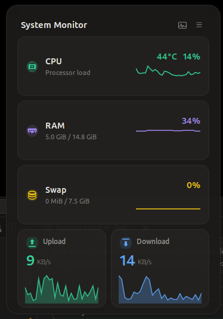

# System Monitor

A lightweight KDE Plasma 6 widget that keeps the same compact panel UI, popup layout, and feature set from the original project while targeting Plasma instead of GNOME Shell.

## Features

- CPU usage with color thresholds
- CPU temperature in the popup
- GPU monitoring for NVIDIA and AMD
- RAM and swap usage with detailed values
- Live upload and download speeds
- Monochrome mode
- Per-metric visibility toggles
- Adjustable refresh interval

## Installation

```bash
git clone https://github.com/talhasiddique7/sys-monitor.git
cd sys-monitor
chmod +x install.sh
./install.sh
```

Then add the **System Monitor** widget to your KDE Plasma panel.

## Configuration

Open the widget configuration dialog from Plasma to customize:

- Refresh interval
- Monochrome mode
- Show CPU
- Show RAM
- Show GPU
- Show Swap
- Show Network

## Requirements

- KDE Plasma 6
- `python3`
- Optional NVIDIA support through `nvidia-smi`
- Optional AMD support through `/sys/class/drm/card0/device/gpu_busy_percent`

## Validation

```bash
make check
make pack
```

## Technical Details

The widget reads data locally from:

- `/proc/stat`
- `/proc/meminfo`
- `/proc/net/dev`
- `/sys/class/hwmon`
- `/sys/class/thermal`

## Screenshots




## License

MIT License - see [LICENSE](LICENSE).
